# 🌱 EcoPlatform - Plateforme de Gamification Écologique

Une plateforme web complète et moderne conçue pour encourager les actions écologiques à travers la gamification. Les utilisateurs peuvent déclarer des activités écologiques, gagner des points et des badges, débloquer des récompenses, et participer à un classement communautaire.

## ✨ Fonctionnalités Clés

### 🎯 Système de Gamification Complet
- **Déclaration d'actions écologiques** : Enregistrez vos activités durables (tri, recyclage, compostage, plantation, etc.)
- **Système de points et badges** : Gagnez des points et débloquez des badges selon vos accomplissements
- **Défis et récompenses** : Relevez des défis et échangez vos points contre des récompenses
- **Classement communautaire** : Comparez votre progression avec d'autres utilisateurs
- **Tableau de bord personnalisé** : Suivez vos statistiques et votre impact écologique

### 🔐 Gestion Sécurisée des Comptes
- **Vérification d'email obligatoire** : Système de confirmation par email lors de la création de compte pour garantir la sécurité
- **Réinitialisation de mot de passe** : Fonctionnalité complète de récupération de compte via email en cas d'oubli
- **Authentification sécurisée** : Protection des données et des accès utilisateurs

### 📱 Design Responsive
L'application est **entièrement responsive** et optimisée pour tous les appareils :
- 💻 Desktop (ordinateurs de bureau)
- 💼 Tablettes (iPad, Android tablets)
- 📱 Smartphones (iOS, Android)

L'interface s'adapte automatiquement à la taille de votre écran pour une expérience utilisateur optimale sur tous les supports.

### 🔔 Système de Notifications & Feedback Utilisateur
- **Notifications backend en temps réel** : Système de notifications côté serveur pour les événements importants
- **Feedback visuel élégant** : Alertes toast avec **Ngx-toastr** pour informer l'utilisateur du succès/échec des opérations (création, modification, suppression)
- **Confirmations interactives** : Dialogues modaux avec **SweetAlert2** pour confirmer les actions critiques avant leur exécution

### 👨‍💼 Interface d'Administration
- Statistiques détaillées et tableaux de bord analytics
- Gestion complète des utilisateurs, badges, défis et récompenses
- Modération des actions déclarées
- Consultation du profile

### 👨‍💼 Interface d'utilisateur
- Statistiques détaillées et tableaux de bord analytics
- Déclaration des actions déclarées
- Consultation badges, défis et récompenses
- Consultation du profile

---

## 📸 Aperçu de l'Application

### Page d'Accueil

*Transformez vos gestes écologiques en récompenses*

### Fonctionnement de la Plateforme
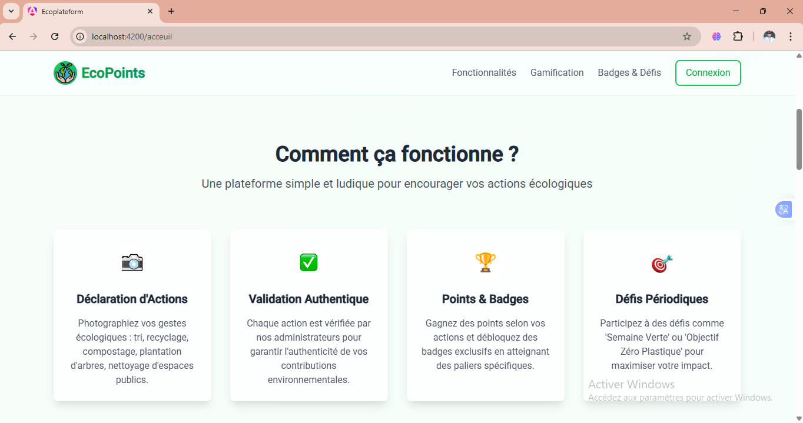
*Une plateforme simple et ludique pour encourager vos actions écologiques*

### Actions Écologiques Disponibles
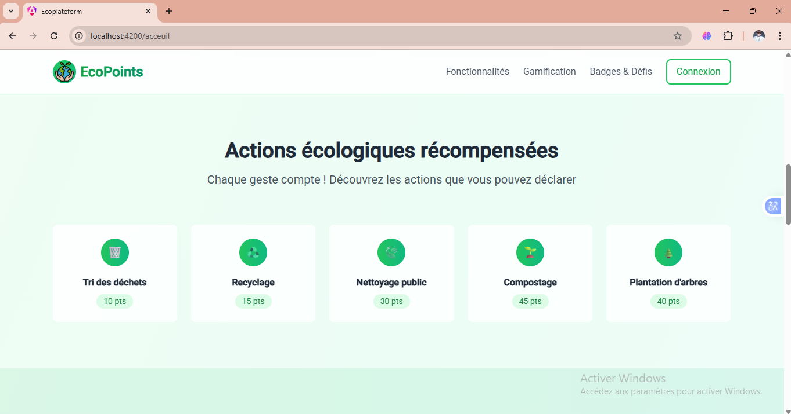
*Découvrez les actions que vous pouvez déclarer : tri des déchets, recyclage, nettoyage public, compostage, plantation d'arbres*

### Système de Gamification

*Points, badges, défis, récompenses : chaque action compte, chaque effort est valorisé !*

### Badges & Défis
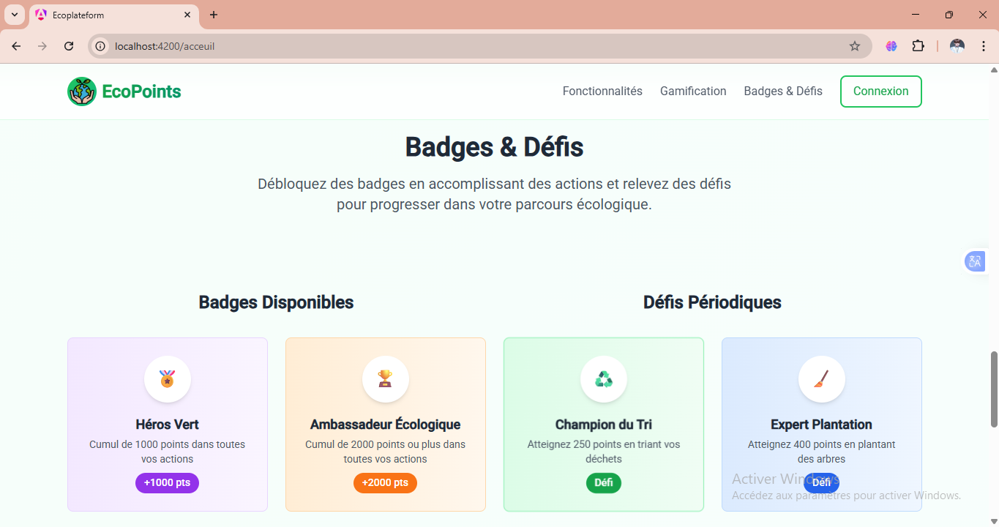
*Débloquez des badges en accomplissant des actions et relevez des défis pour progresser*

### Connexion
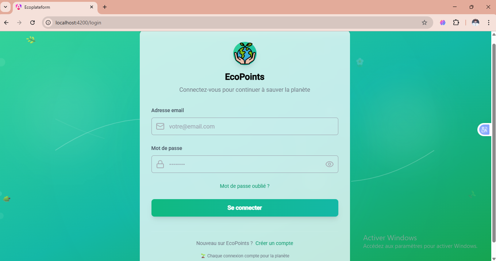
*Connectez-vous pour continuer à sauver la planète*

### Création de Compte


*Processus d'inscription simple et sécurisé*

### Vérification par Email
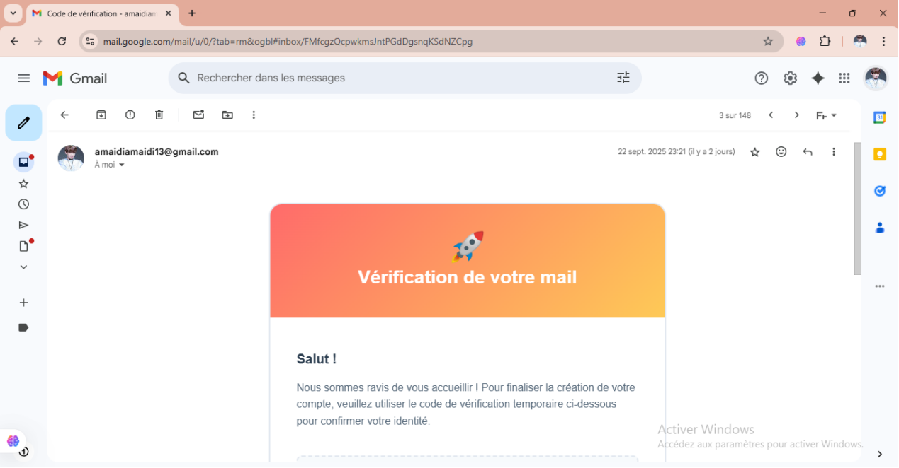
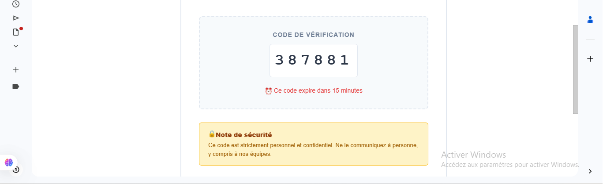
*Système de vérification d'email pour sécuriser votre compte*

### Dashboard Administrateur
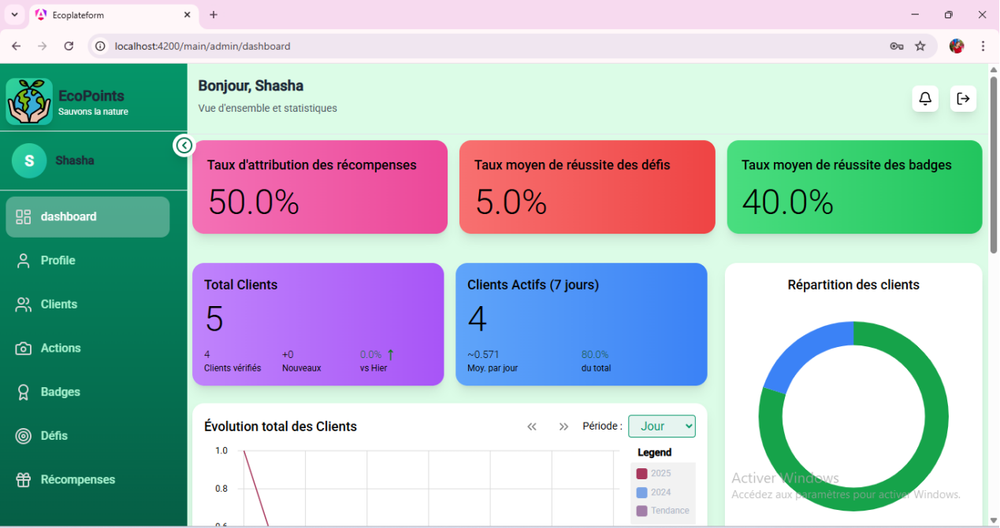
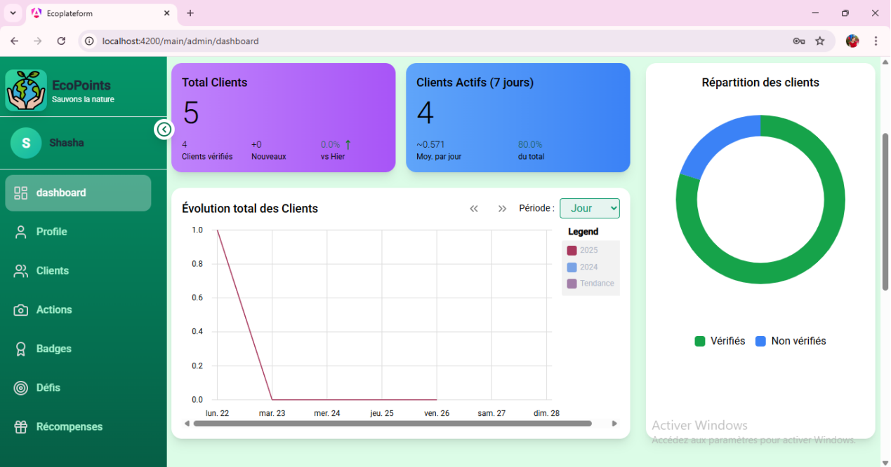
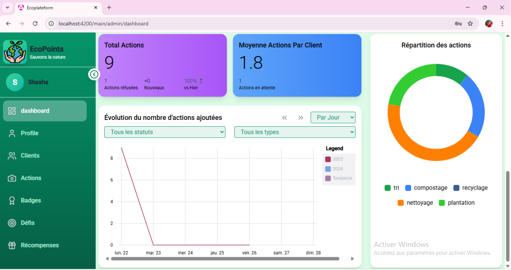
*Tableau de bord complet avec statistiques et analytics*

### Sections d'Administration

*Gestion du profil administrateur*


*Gestion des utilisateurs*

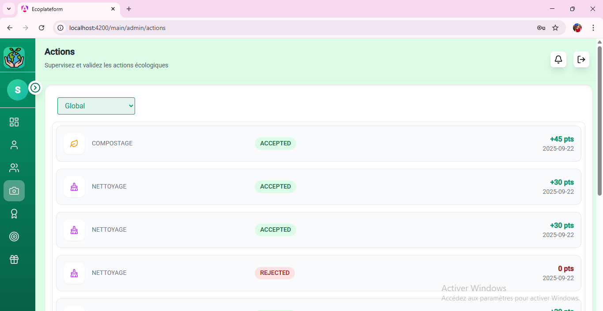
*Gestion des actions écologiques*

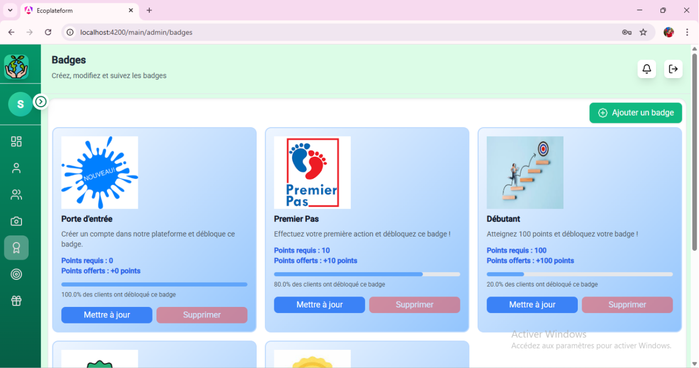
*Gestion des badges*


*Gestion des défis*


*Gestion des récompenses*

---

## 💻 Stack Technologique

### Backend
- **Framework** : Spring Boot 3.5.3
- **Langage** : Java 17
- **Gestion des dépendances** : Maven
- **Persistance** : Spring Data JPA
- **Base de données** : MySQL (compatible avec PostgreSQL et autres)
- **Documentation API** : OpenAPI 3.0 / Swagger UI
- **Email** : Spring Mail avec support SMTP

### Frontend
- **Framework** : Angular 20
- **Langage** : TypeScript
- **Styling** : Tailwind CSS
- **Notifications** : Ngx-toastr (toast notifications élégantes)
- **Modales** : SweetAlert2 (dialogues interactifs)
- **Build** : Angular CLI avec optimisation production
- **PostCSS** : Traitement CSS avancé

### DevOps & Infrastructure
- **Conteneurisation** : Docker
- **Orchestration** : Docker Compose
- **Serveur Web** : Nginx (pour le frontend)
- **Proxy Reverse** : Configuration Nginx optimisée

---

## 📋 Prérequis

Avant de commencer, assurez-vous d'avoir installé :

- **Java** 17 ou supérieur
- **Node.js** 18+ et npm
- **Docker** et Docker Compose
- **MySQL** 8.0+ (ou autre base SQL compatible)
- **Git** pour cloner le repository

---

## 🚀 Installation et Démarrage

### Option 1 : Avec Docker Compose (Recommandé) ⭐

C'est la méthode la plus simple pour déployer l'application complète avec tous ses services.

#### Étape 1 : Cloner le Repository
```bash
git clone https://github.com/shaimaamaidi/eco-gamification-platform.git
cd eco-gamification-platform
```

#### Étape 2 : Compiler les Projets

##### Backend
```bash
cd backend

# Sur Linux/Mac
./mvnw clean package

# Sur Windows
mvnw.cmd clean package
```

##### Frontend
```bash
cd frontend

# Installer les dépendances
npm install

# Compiler pour la production
npm run build --configuration production
```

#### Étape 3 : Configurer les Variables d'Environnement
```bash
# Copier le fichier d'exemple
cp .env.example .env

# Éditer le fichier .env avec vos paramètres
nano .env  # ou utilisez votre éditeur préféré
```

**Variables importantes à configurer dans `.env` :**
```dotenv
# Base de données
MYSQL_ROOT_PASSWORD=votre_mot_de_passe_securise

# Email (pour vérification et réinitialisation)
SPRING_MAIL_USERNAME=votre-email@gmail.com
SPRING_MAIL_PASSWORD=votre-mot-de-passe-application

# Chemin du projet
PROJECT_PATH=/chemin/vers/le/projet
```

#### Étape 4 : Démarrer l'Application
```bash
# Démarrer tous les services en arrière-plan
docker-compose up --build -d

# Ou pour voir les logs en temps réel
docker-compose up --build
```

#### Étape 5 : Accéder à l'Application

Une fois les conteneurs démarrés, accédez aux différents services :

- **Frontend (Application)** : http://localhost:4200
- **Backend API** : http://localhost:8080
- **Documentation API (Swagger)** : http://localhost:8080/swagger-ui.html

#### Commandes Utiles

```bash
# Voir les logs des conteneurs
docker-compose logs -f

# Arrêter les conteneurs (données préservées)
docker-compose stop

# Redémarrer les conteneurs
docker-compose start

# Arrêter et supprimer les conteneurs (⚠️ données supprimées)
docker-compose down -v

# Reconstruire les images
docker-compose build --no-cache
```

---

### Option 2 : Installation Locale (Développement)

Pour un environnement de développement local sans Docker.

#### Backend
```bash
cd backend

# Configurer application.properties avec votre base de données locale
# Démarrer l'application
./mvnw spring-boot:run
```

#### Frontend
```bash
cd frontend

# Installer les dépendances
npm install

# Démarrer le serveur de développement
ng serve

# L'application sera accessible sur http://localhost:4200
```

---

## 📁 Structure du Projet

```
eco-gamification-platform/
│
├── backend/                          # Application Spring Boot
│   ├── src/
│   │   ├── main/
│   │   │   ├── java/com/whitecape/  # Code source Java
│   │   │   │   ├── controllers/     # Contrôleurs REST
│   │   │   │   ├── services/        # Logique métier
│   │   │   │   ├── repositories/    # Accès données
│   │   │   │   ├── models/          # Entités JPA
│   │   │   │   └── config/          # Configuration
│   │   │   └── resources/
│   │   │       ├── application.properties
│   │   │       └── data.sql         # Données initiales
│   │   └── test/                    # Tests unitaires
│   ├── pom.xml                      # Dépendances Maven
│   ├── Dockerfile                   # Image Docker backend
│   └── mvnw                         # Maven wrapper
│
├── frontend/                        # Application Angular
│   ├── src/
│   │   ├── app/
│   │   │   ├── components/         # Composants réutilisables
│   │   │   ├── pages/              # Pages de l'application
│   │   │   ├── services/           # Services Angular
│   │   │   ├── models/             # Interfaces TypeScript
│   │   │   ├── guards/             # Guards de routing
│   │   │   └── interceptors/       # Intercepteurs HTTP
│   │   ├── assets/                 # Ressources statiques
│   │   ├── index.html
│   │   └── main.ts
│   ├── angular.json                # Configuration Angular
│   ├── package.json                # Dépendances npm
│   ├── tailwind.config.js          # Configuration Tailwind
│   ├── Dockerfile                  # Image Docker frontend
│   └── nginx.conf                  # Configuration Nginx
│
├── assets/
│   └── images/                     # Screenshots de l'application
│
├── docker-compose.yml              # Orchestration des services
├── .env.example                    # Template variables d'environnement
├── .gitignore
└── README.md                       # Ce fichier
```

---

## 🔧 Configuration

### Variables d'Environnement

#### Créer votre fichier .env
```bash
cp .env.example .env
```

#### Exemple de configuration (.env)
```dotenv
# === Base de Données MySQL ===
MYSQL_DATABASE=ecoplateform
MYSQL_ROOT_PASSWORD=MotDePasseSecurise123!

# === Configuration Spring Boot ===
SPRING_DATASOURCE_URL=jdbc:mysql://mysqldb:3306/ecoplateform
SPRING_DATASOURCE_USERNAME=root
SPRING_DATASOURCE_PASSWORD=MotDePasseSecurise123!

# === Configuration Email (Gmail) ===
SPRING_MAIL_USERNAME=votre-email@gmail.com
SPRING_MAIL_PASSWORD=xxxx-xxxx-xxxx-xxxx

# === Autres ===
PROJECT_PATH=/chemin/vers/eco-gamification-platform
```

### Configuration Email pour Gmail

Pour utiliser Gmail avec l'application :

1. **Activer l'authentification à 2 facteurs** sur votre compte Google
2. **Générer un mot de passe d'application** :
   - Accédez à [Sécurité Google](https://myaccount.google.com/security)
   - Sélectionnez "Mots de passe des applications"
   - Générez un nouveau mot de passe pour "Mail"
3. **Utilisez ce mot de passe** dans `SPRING_MAIL_PASSWORD` (format: xxxx-xxxx-xxxx-xxxx)

📚 [Guide complet : Mots de passe d'application Google](https://support.google.com/accounts/answer/185833)

---

## 📚 Documentation API

L'API REST est entièrement documentée avec **OpenAPI 3.0** et **Swagger UI**.

### Accéder à la Documentation

Après avoir démarré le backend, rendez-vous sur :
```
http://localhost:8080/swagger-ui.html
```

### Fichier OpenAPI

Le schéma OpenAPI complet est disponible dans :
```
frontend/src/openapi/openapi.json
```

---

## 🔐 Authentification et Accès

### Compte Administrateur

Un compte administrateur est créé automatiquement au démarrage via le script `data.sql`.

**Identifiants Admin par défaut :**
```
Email    : admin@eco.com
Password : admin123
```

### Compte Utilisateur

Pour créer un compte utilisateur :

1. **Inscription** : Cliquez sur "S'inscrire" depuis la page de connexion
2. **Formulaire** : Remplissez vos informations (nom, prénom, email, ville, mot de passe)
3. **Email de vérification** : Un email vous sera envoyé automatiquement
4. **Confirmation** : Cliquez sur le lien dans l'email pour activer votre compte
5. **Connexion** : Connectez-vous avec vos identifiants

### Fonctionnalités Email

#### 📧 Vérification d'Email (Inscription)
- Email automatique envoyé lors de la création de compte
- Lien de vérification valide pendant 15 minutes
- Le compte reste inactif tant que l'email n'est pas vérifié
- Protection contre les faux comptes

#### 🔑 Réinitialisation de Mot de Passe
- Accessible via "Mot de passe oublié ?" sur la page de connexion
- Email contenant un lien de réinitialisation sécurisé
- Lien valide pendant 1 heure
- Création d'un nouveau mot de passe sécurisé

---

## 👥 Auteur

**Amaidi Chaima**
- 📧 Email : [amaidi.shaima@gmail.com](mailto:amaidi.shaima@gmail.com)
- 🔗 GitHub : [@shaimaamaidi](https://github.com/shaimaamaidi)
- 📅 Année : 2024-2025

---

## 📚 Ressources et Documentation

### Documentation Officielle
- [Spring Boot](https://spring.io/projects/spring-boot) - Framework backend
- [Angular](https://angular.io/docs) - Framework frontend
- [Tailwind CSS](https://tailwindcss.com/docs) - Framework CSS
- [Docker](https://docs.docker.com/) - Conteneurisation
- [MySQL](https://dev.mysql.com/doc/) - Base de données

### Guides Utiles
- [Spring Data JPA](https://spring.io/projects/spring-data-jpa)
- [Angular Routing](https://angular.io/guide/router)
- [Tailwind Responsive Design](https://tailwindcss.com/docs/responsive-design)
- [Docker Compose](https://docs.docker.com/compose/)

---

## 🐛 Résolution de Problèmes

### Problème : Le backend ne démarre pas
**Solution** : Vérifiez que MySQL est démarré et que les identifiants dans `.env` sont corrects.

### Problème : Les emails ne sont pas envoyés
**Solution** : Vérifiez votre configuration SMTP dans fichier .env et que vous utilisez un mot de passe d'application (pas votre mot de passe Gmail).

---


⭐ **Si ce projet vous est utile, n'oubliez pas de lui donner une étoile sur GitHub !**

🌍 **Ensemble, sauvons la planète, une action à la fois.**