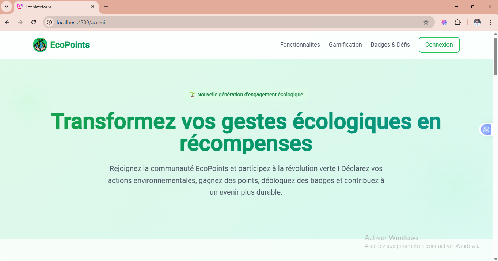
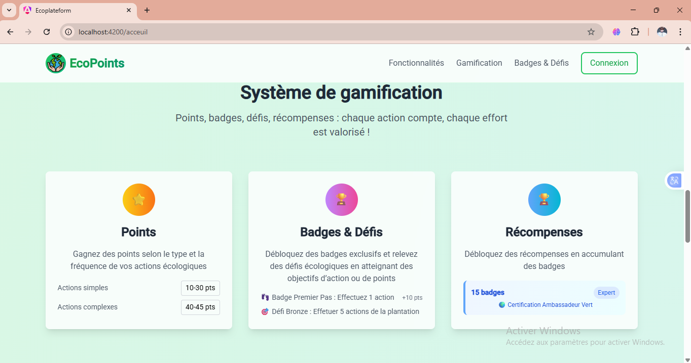
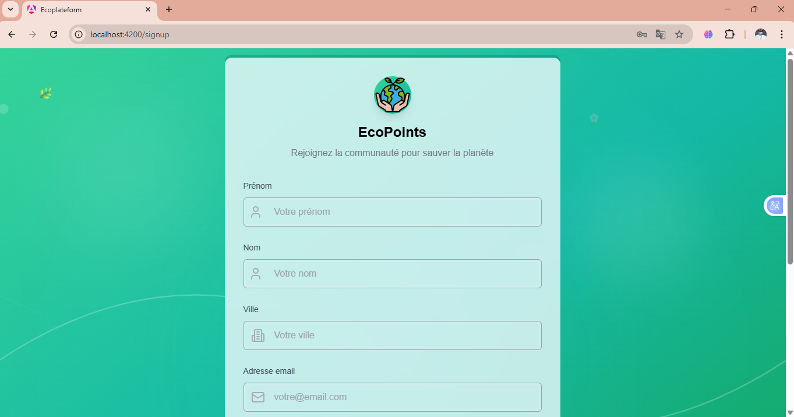
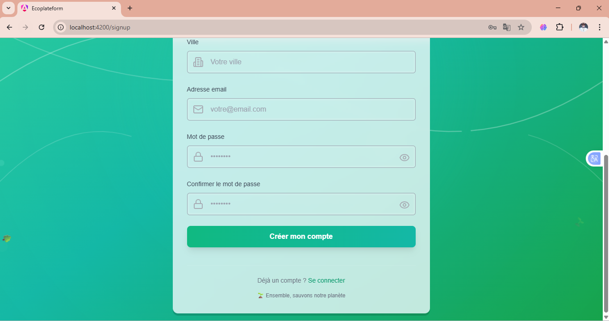
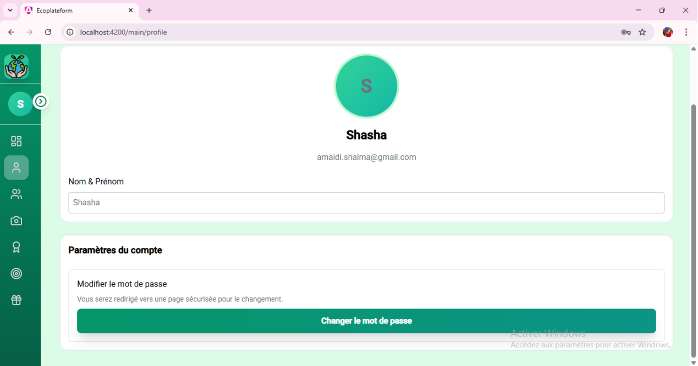
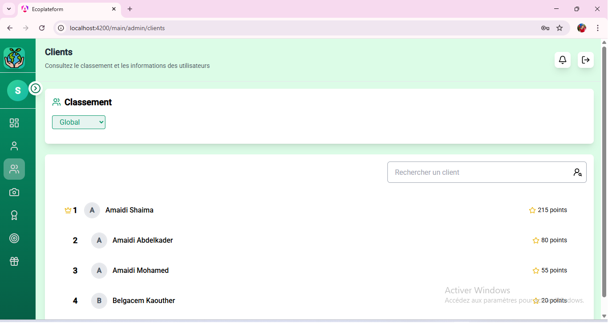
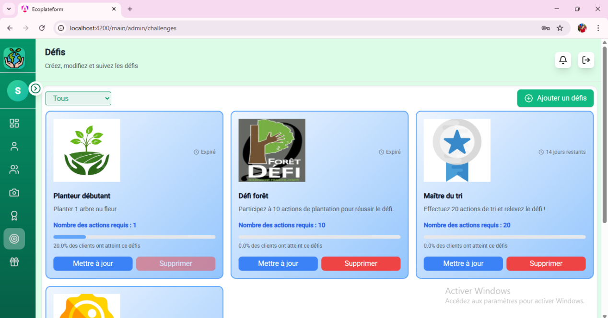
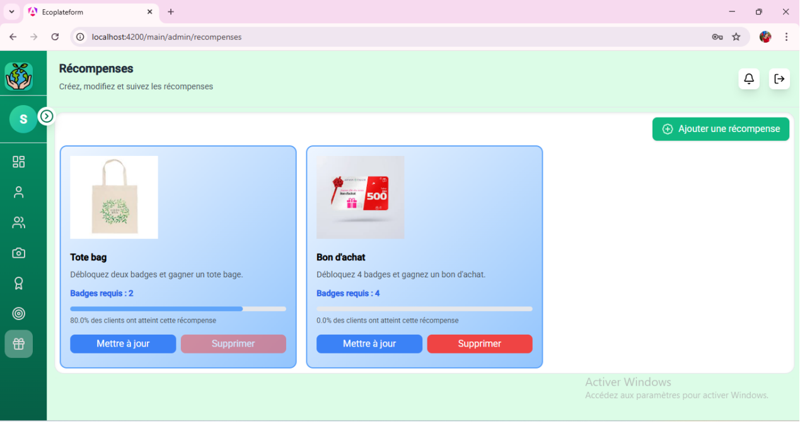

# 🌱 EcoPlatform - Plateforme de Gamification Écologique

Une plateforme web complète et moderne conçue pour encourager les actions écologiques à travers la gamification. Les utilisateurs peuvent déclarer des activités écologiques, gagner des points et des badges, débloquer des récompenses, et participer à un classement communautaire.

## ✨ Fonctionnalités Clés

### 🎯 Système de Gamification Complet
- **Déclaration d'actions écologiques** : Enregistrez vos activités durables (tri, recyclage, compostage, plantation, etc.)
- **Système de points et badges** : Gagnez des points et débloquez des badges selon vos accomplissements
- **Défis et récompenses** : Relevez des défis et échangez vos points contre des récompenses
- **Classement communautaire** : Comparez votre progression avec d'autres utilisateurs
- **Tableau de bord personnalisé** : Suivez vos statistiques et votre impact écologique

### 🔐 Gestion Sécurisée des Comptes
- **Authentification JWT** : Système d'authentification sécurisé basé sur JSON Web Tokens pour protéger les accès et maintenir les sessions utilisateur
- **Vérification d'email obligatoire** : Système de confirmation par email lors de la création de compte pour garantir la sécurité
- **Réinitialisation de mot de passe** : Fonctionnalité complète de récupération de compte via email en cas d'oubli
- **Protection des routes** : Guards Angular pour sécuriser l'accès aux pages selon les rôles utilisateur

### 📱 Design Responsive
L'application est **entièrement responsive** et optimisée pour tous les appareils :
- 💻 Desktop (ordinateurs de bureau)
- 💼 Tablettes (iPad, Android tablets)
- 📱 Smartphones (iOS, Android)

L'interface s'adapte automatiquement à la taille de votre écran pour une expérience utilisateur optimale sur tous les supports.

### 🔔 Système de Notifications & Feedback Utilisateur
- **WebSocket pour notifications en temps réel** : Communication bidirectionnelle instantanée via STOMP/SockJS pour recevoir des notifications push sans rafraîchissement de page
- **Notifications backend persistantes** : Système de notifications côté serveur pour les événements importants (nouveaux badges, défis complétés, récompenses débloquées)
- **Feedback visuel élégant** : Alertes toast avec **Ngx-toastr** pour informer l'utilisateur du succès/échec des opérations (création, modification, suppression)
- **Confirmations interactives** : Dialogues modaux avec **SweetAlert2** pour confirmer les actions critiques avant leur exécution

### 👨‍💼 Interface d'Administration
- Statistiques détaillées et tableaux de bord analytics
- Gestion complète des utilisateurs, badges, défis et récompenses
- Modération des actions déclarées
- Consultation du profil

### 👤 Interface Utilisateur
- Statistiques détaillées et tableaux de bord analytics
- Déclaration des actions écologiques
- Consultation badges, défis et récompenses
- Consultation du profil

---

## 📸 Aperçu de l'Application

### Page d'Accueil

*Transformez vos gestes écologiques en récompenses*

### Fonctionnement de la Plateforme

*Une plateforme simple et ludique pour encourager vos actions écologiques*

### Actions Écologiques Disponibles

*Découvrez les actions que vous pouvez déclarer : tri des déchets, recyclage, nettoyage public, compostage, plantation d'arbres*

### Système de Gamification

*Points, badges, défis, récompenses : chaque action compte, chaque effort est valorisé !*

### Badges & Défis

*Débloquez des badges en accomplissant des actions et relevez des défis pour progresser*

### Connexion

*Connectez-vous pour continuer à sauver la planète*

### Création de Compte


*Processus d'inscription simple et sécurisé*

### Vérification par Email


*Système de vérification d'email pour sécuriser votre compte*

### Dashboard Administrateur


*Tableau de bord complet avec statistiques et analytics*

### Sections d'Administration

*Gestion du profil administrateur*


*Gestion des utilisateurs*


*Gestion des actions écologiques*


*Gestion des badges*


*Gestion des défis*


*Gestion des récompenses*

---

## 💻 Stack Technologique

### Backend
- **Framework** : Spring Boot 3.5.3
- **Langage** : Java 17
- **Gestion des dépendances** : Maven
- **Persistance** : Spring Data JPA
- **Base de données** : MySQL (compatible avec PostgreSQL et autres)
- **Sécurité** : Spring Security avec JWT (JSON Web Tokens) pour l'authentification stateless
- **WebSocket** : Spring WebSocket avec STOMP pour les notifications en temps réel
- **Documentation API** : OpenAPI 3.0 / Swagger UI pour documentation interactive et génération de clients
- **Email** : Spring Mail avec support SMTP

### Frontend
- **Framework** : Angular 20
- **Langage** : TypeScript
- **Styling** : Tailwind CSS
- **WebSocket Client** : SockJS et STOMP.js pour communication temps réel avec le backend
- **Génération de clients API** : ng-openapi-gen pour générer automatiquement les services TypeScript depuis le schéma OpenAPI
- **Notifications** : Ngx-toastr (toast notifications élégantes)
- **Modales** : SweetAlert2 (dialogues interactifs)
- **Build** : Angular CLI avec optimisation production
- **PostCSS** : Traitement CSS avancé

### DevOps & Infrastructure
- **Conteneurisation** : Docker
- **Orchestration** : Docker Compose
- **Serveur Web** : Nginx (pour le frontend)
- **Proxy Reverse** : Configuration Nginx optimisée

---

## 📋 Prérequis

Avant de commencer, assurez-vous d'avoir installé :

- **Java** 17 ou supérieur
- **Node.js** 18+ et npm
- **Docker** et Docker Compose
- **MySQL** 8.0+ (ou autre base SQL compatible)
- **Git** pour cloner le repository

---

## 🚀 Installation et Démarrage

### Option 1 : Avec Docker Compose (Recommandé) ⭐

C'est la méthode la plus simple pour déployer l'application complète avec tous ses services.

#### Étape 1 : Cloner le Repository
```bash
git clone https://github.com/shaimaamaidi/eco-gamification-platform.git
cd eco-gamification-platform
```

#### Étape 2 : Compiler les Projets

##### Backend
```bash
cd backend

# Sur Linux/Mac
./mvnw clean package

# Sur Windows
mvnw.cmd clean package
```

##### Frontend
```bash
cd frontend

# Installer les dépendances
npm install

# Compiler pour la production
npm run build --configuration production
```

#### Étape 3 : Configurer les Variables d'Environnement
```bash
# Copier le fichier d'exemple
cp .env.example .env

# Éditer le fichier .env avec vos paramètres
nano .env  # ou utilisez votre éditeur préféré
```

**Variables importantes à configurer dans `.env` :**
```dotenv
# Base de données
MYSQL_ROOT_PASSWORD=votre_mot_de_passe_securise

# Email (pour vérification et réinitialisation)
SPRING_MAIL_USERNAME=votre-email@gmail.com
SPRING_MAIL_PASSWORD=votre-mot-de-passe-application

# JWT (optionnel - valeurs par défaut fournies)
JWT_SECRET=votre_secret_jwt_securise
JWT_EXPIRATION=1800000
JWT_REFRESH_TOKEN_EXPIRATION=86400000

# Chemin du projet
PROJECT_PATH=/chemin/vers/le/projet
```

#### Étape 4 : Démarrer l'Application
```bash
# Démarrer tous les services en arrière-plan
docker-compose up --build -d

# Ou pour voir les logs en temps réel
docker-compose up --build
```

#### Étape 5 : Accéder à l'Application

Une fois les conteneurs démarrés, accédez aux différents services :

- **Frontend (Application)** : http://localhost:4200
- **Backend API** : http://localhost:8080
- **Documentation API (Swagger)** : http://localhost:8080/swagger-ui.html
- **WebSocket Endpoint** : ws://localhost:8080/ws (automatiquement géré par l'application)

#### Commandes Utiles

```bash
# Voir les logs des conteneurs
docker-compose logs -f

# Arrêter les conteneurs (données préservées)
docker-compose stop

# Redémarrer les conteneurs
docker-compose start

# Arrêter et supprimer les conteneurs (⚠️ données supprimées)
docker-compose down -v

# Reconstruire les images
docker-compose build --no-cache
```

---

### Option 2 : Installation Locale (Développement)

Pour un environnement de développement local sans Docker.

#### Backend
```bash
cd backend

# Configurer application.properties avec votre base de données locale
# Démarrer l'application
./mvnw spring-boot:run
```

#### Frontend
```bash
cd frontend

# Installer les dépendances
npm install

# Démarrer le serveur de développement
ng serve

# L'application sera accessible sur http://localhost:4200
```

---

## 📁 Structure du Projet

```
eco-gamification-platform/
│
├── backend/                          # Application Spring Boot
│   ├── src/
│   │   ├── main/
│   │   │   ├── java/com/whitecape/  # Code source Java
│   │   │   │   ├── controllers/     # Contrôleurs REST
│   │   │   │   ├── services/        # Logique métier
│   │   │   │   ├── repositories/    # Accès données
│   │   │   │   ├── models/          # Entités JPA
│   │   │   │   └── config/          # Configuration
│   │   │   └── resources/
│   │   │       ├── application.properties
│   │   │       └── data.sql         # Données initiales
│   │   └── test/                    # Tests unitaires
│   ├── pom.xml                      # Dépendances Maven
│   ├── Dockerfile                   # Image Docker backend
│   └── mvnw                         # Maven wrapper
│
├── frontend/                        # Application Angular
│   ├── src/
│   │   ├── app/
│   │   │   ├── components/         # Composants réutilisables
│   │   │   ├── pages/              # Pages de l'application
│   │   │   ├── services/           # Services Angular
│   │   │   ├── models/             # Interfaces TypeScript
│   │   │   ├── guards/             # Guards de routing
│   │   │   └── interceptors/       # Intercepteurs HTTP
│   │   ├── assets/                 # Ressources statiques
│   │   ├── index.html
│   │   └── main.ts
│   ├── angular.json                # Configuration Angular
│   ├── package.json                # Dépendances npm
│   ├── tailwind.config.js          # Configuration Tailwind
│   ├── Dockerfile                  # Image Docker frontend
│   └── nginx.conf                  # Configuration Nginx
│
├── assets/
│   └── images/                     # Screenshots de l'application
│
├── docker-compose.yml              # Orchestration des services
├── .env.example                    # Template variables d'environnement
├── .gitignore
└── README.md                       # Ce fichier
```

---

## 🔧 Configuration

### Variables d'Environnement

#### Créer votre fichier .env
```bash
cp .env.example .env
```

#### Exemple de configuration (.env)
```dotenv
# === Base de Données MySQL ===
MYSQL_DATABASE=ecoplateform
MYSQL_ROOT_PASSWORD=MotDePasseSecurise123!

# === Configuration Spring Boot ===
SPRING_DATASOURCE_URL=jdbc:mysql://mysqldb:3306/ecoplateform
SPRING_DATASOURCE_USERNAME=root
SPRING_DATASOURCE_PASSWORD=MotDePasseSecurise123!

# === Configuration Email (Gmail) ===
SPRING_MAIL_USERNAME=votre-email@gmail.com
SPRING_MAIL_PASSWORD=xxxx-xxxx-xxxx-xxxx

# === Configuration JWT ===
JWT_SECRET=VotreCleSecreteTresLongueEtSecurisee123456789
JWT_EXPIRATION=1800000
JWT_REFRESH_TOKEN_EXPIRATION=86400000

# === Autres ===
PROJECT_PATH=/chemin/vers/eco-gamification-platform
```

### Configuration Email pour Gmail

Pour utiliser Gmail avec l'application :

1. **Activer l'authentification à 2 facteurs** sur votre compte Google
2. **Générer un mot de passe d'application** :
   - Accédez à [Sécurité Google](https://myaccount.google.com/security)
   - Sélectionnez "Mots de passe des applications"
   - Générez un nouveau mot de passe pour "Mail"
3. **Utilisez ce mot de passe** dans `SPRING_MAIL_PASSWORD` (format: xxxx-xxxx-xxxx-xxxx)

📚 [Guide complet : Mots de passe d'application Google](https://support.google.com/accounts/answer/185833)

---

## 📚 Documentation API

L'API REST est entièrement documentée avec **OpenAPI 3.0** et **Swagger UI**.

### Accéder à la Documentation Interactive

Après avoir démarré le backend, rendez-vous sur :
```
http://localhost:8080/swagger-ui.html
```

Swagger UI vous permet de :
- 📖 Consulter tous les endpoints disponibles
- 🧪 Tester les API directement depuis le navigateur
- 📝 Voir les modèles de données et schémas
- 🔐 Tester avec authentification JWT

### Fichier OpenAPI

Le schéma OpenAPI complet est disponible dans :
```
frontend/src/openapi/openapi.json
```

### Génération Automatique des Clients API

Le projet utilise **ng-openapi-gen** pour générer automatiquement les services TypeScript depuis la spécification OpenAPI :

```bash
# Depuis le dossier frontend
npm run api-gen

# Cela génère les services dans src/openapi/generated/
```

**Avantages** :
- ✅ Types TypeScript fortement typés
- ✅ Synchronisation automatique avec le backend
- ✅ Réduction des erreurs de développement
- ✅ Autocomplétion IDE complète

---

## 🔐 Authentification et Sécurité

### Architecture de Sécurité JWT

L'application utilise **JSON Web Tokens (JWT)** pour une authentification stateless et sécurisée :

**Flux d'authentification** :
1. L'utilisateur se connecte avec email/mot de passe
2. Le backend génère un JWT signé contenant l'ID utilisateur et le rôle
3. Le token est stocké côté client (localStorage)
4. Chaque requête HTTP inclut le token dans l'en-tête `Authorization: Bearer <token>`
5. Le backend valide le token et autorise l'accès aux ressources protégées

**Sécurité** :
- Tokens signés avec secret cryptographique
- Double expiration : Access Token (30 min) et Refresh Token (24h)
- Renouvellement automatique des tokens via Refresh Token
- Protection CSRF grâce à l'architecture stateless
- Guards Angular pour protéger les routes frontend
- Intercepteurs HTTP pour injection automatique des tokens

### Compte Administrateur

Un compte administrateur est créé automatiquement au démarrage via le script `data.sql`.

**Identifiants Admin par défaut :**
```
Email    : admin@eco.com
Password : admin123
```

### Compte Utilisateur

Pour créer un compte utilisateur :

1. **Inscription** : Cliquez sur "S'inscrire" depuis la page de connexion
2. **Formulaire** : Remplissez vos informations (nom, prénom, email, ville, mot de passe)
3. **Email de vérification** : Un email vous sera envoyé automatiquement
4. **Confirmation** : Cliquez sur le lien dans l'email pour activer votre compte
5. **Connexion** : Connectez-vous avec vos identifiants et recevez votre JWT

### Fonctionnalités Email

#### 📧 Vérification d'Email (Inscription)
- Email automatique envoyé lors de la création de compte
- Lien de vérification valide pendant 15 minutes
- Le compte reste inactif tant que l'email n'est pas vérifié
- Protection contre les faux comptes

#### 🔑 Réinitialisation de Mot de Passe
- Accessible via "Mot de passe oublié ?" sur la page de connexion
- Email contenant un lien de réinitialisation sécurisé
- Lien valide pendant 1 heure
- Création d'un nouveau mot de passe sécurisé

---

## 🔔 Système de Notifications en Temps Réel

### Architecture WebSocket

L'application utilise **WebSocket** avec le protocole **STOMP** (Simple Text Oriented Messaging Protocol) sur **SockJS** pour les notifications push en temps réel.

**Fonctionnement** :
1. Le client établit une connexion WebSocket persistante au démarrage
2. Le client s'abonne aux topics de notifications 
3. Le backend envoie des notifications instantanément via WebSocket
4. Les notifications apparaissent en temps réel sans rafraîchissement de page

**Technologies** :
- **Backend** : Spring WebSocket + STOMP
- **Frontend** : SockJS-client + STOMP.js
- **Transport** : WebSocket avec fallback HTTP long-polling

**Types de notifications** :
- 🏆 Nouveau badge débloqué
- ✅ Défi complété
- 🎁 Récompense obtenue
- ⭐ Nouveau niveau atteint
- 📊 Mise à jour du classement

---

## 👥 Auteur

**Amaidi Chaima**
- 📧 Email : [amaidi.shaima@gmail.com](mailto:amaidi.shaima@gmail.com)
- 🔗 GitHub : [@shaimaamaidi](https://github.com/shaimaamaidi)
- 📅 Année : 2024-2025

---

## 🐛 Résolution de Problèmes

### Problème : Le backend ne démarre pas
**Solution** : Vérifiez que MySQL est démarré et que les identifiants dans `.env` sont corrects.

### Problème : Les emails ne sont pas envoyés
**Solution** : Vérifiez votre configuration SMTP dans fichier .env et que vous utilisez un mot de passe d'application (pas votre mot de passe Gmail).

---

⭐ **Si ce projet vous est utile, n'oubliez pas de lui donner une étoile sur GitHub !**

🌍 **Ensemble, sauvons la planète, une action à la fois.**